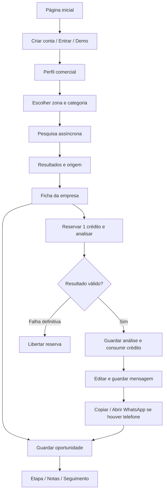

# Fluxos do utilizador

Privacidade: Conta → Exportar → Descarregar JSON; ou Conta → Pedir eliminação → Administração → Processar. A eliminação remove os dados privados da conta; o catálogo partilhado autorizado permanece.

Não contacto: Ficha → Motivo → Bloqueio no espaço. Correcção: Ficha → Sinalizar → Administração → Rever. A revisão sinaliza que o pedido foi lido; a alteração do catálogo requer reimportação autorizada da linha corrigida.

Recuperação demo: pedir na entrada, consultar caixa local pela conta ainda autenticada ou pelo operador com scripts/outbox.ts, abrir ligação e definir nova palavra-passe. Produção: depende do serviço de autenticação e correio configurados.
